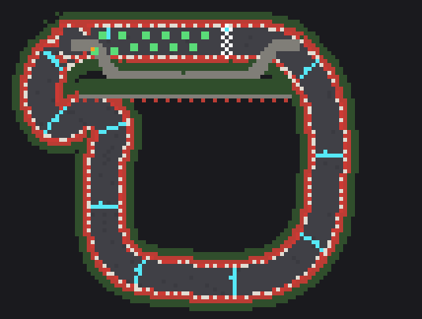
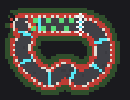
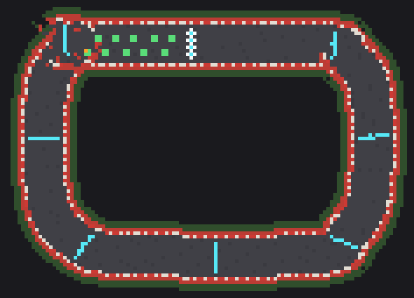
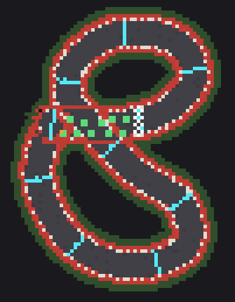
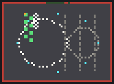

# FabricRacers

**A complete racing game inside Minecraft** - build a circuit anywhere, tune your
car, and race it solo, against AI drivers, or against your friends.

Everything is original content for Minecraft **1.21.1** on Fabric: cars you can
drive and tune, an AI that actually races, five stock circuits plus a track
builder, a full race engine (grid, countdown, laps, checkpoints, standings,
pit stops, prizes) and a driver profile that remembers every lap you set.

---

## What you get

### Cars
* Nine chassis: Go-Kart, Rally Hatch, Sport Coupe, Hypercar, Formula Racer,
  Baja Truck, Drift Machine, Hot Rod and the secret *Shadow Prototype*.
* Arcade-sim physics: engine, brakes, drag, lateral grip limits, a bicycle-model
  steering box, handbrake slides, weight transfer, drift scoring and real
  crashing. Cars are **server authoritative** - the client only sends input.
* Damage: crashes bend the car and dim the lights, tyres wear with abuse,
  and a wrecked engine needs a wrench.
* Paint: 16 colours, eight of them craftable as paint cans.

### Tuning
Seven systems, each up to level 4, fitted in the **garage** (`G` while sitting
in your car): Engine, Gearbox, Brakes, Tyres, Aero, Chassis and Nitro. Upgrades
are bought from villager mechanics with the parts they sell, won as prizes, or
found in the world.

### AI drivers that actually race
The AI follows a smoothing-spline racing line with its own steering model:
* looks ahead further the faster it goes, brakes for corners from the curvature,
* uses the handbrake to rotate into tight corners (drift-capable cars),
* picks a side and overtakes slower cars instead of ploughing into them,
* uses boost on the straights, makes skill-scaled mistakes,
* re-joins the track when it ends up on the grass, reverses out when stuck,
* rubber-bands gently so a race stays a race.

Hand your own car to the AI (`/race ai on`) and it will lap the circuit while
you watch - handy for testing a layout.

### Circuits
* **Five stock circuits** ship with the mod, generated by a real track builder
  (`tools/gen_tracks.py`): Asphalt Park, Kart Circuit, Speed Oval, Chaos
  Junction and a Drift Arena.
* The **Track Wand** (`/race wand`, creative mode or operator rights) opens the
  catalogue, lets you rotate the layout by 90°, and builds it where you are
  standing - complete with kerbs, barriers, grandstands, an animated start
  gate, checkpoints and a pit lane.

| | | |
| --- | --- | --- |
|  |  |  |
| Asphalt Park | Kart Circuit | Bonneville Oval |
|  |  | |
| Chaos Junction | Drift Arena | |
* **Record your own**: `/race record`, drive a lap, then `/race record` again.
  The mod bakes the lap you drove into a real circuit - kerbs, barriers, grid
  and checkpoints included - and adds it to the catalogue.
* Placement is smart: overlap checks, rotation, and a `/race remove` that only
  clears blocks the track actually placed (your edits survive).

### The race engine
Grid, five-light countdown, lap timing, per-checkpoint progress, live
standings, gap-to-ahead/behind, pit stop counting, fastest lap, DNF handling
when a player leaves, AI take-over after the flag so cars drive themselves home,
and a results ceremony with trophies and emeralds for the podium.

### Stats and progression
Every racer has a profile: races, wins, podiums, DNFs, laps, overtakes, drift
points, distance, top speed, per-track personal bests, cars placed, circuits
recorded, trophies. Titles go from **Walk-on** to **Legend**. Everything is
stored per world in `fabricracers/stats/`.

---

## Controls

| Key | Action |
| --- | --- |
| `W` / `S` | throttle / brake & reverse |
| `A` / `D` | steer |
| `Space` | handbrake (drift) |
| `Left Ctrl` | boost |
| `G` | garage (while sitting in a car) |
| `T` | race control / circuit catalogue |
| `H` | toggle the race HUD |

The HUD shows speed, boost, drift score, lap counter, timing, live standings,
the countdown and every message the race engine sends you.

---

## Commands

Everything the mod does is scriptable - all commands are under `/race`:

```
/race car [type]              get a car (or /race car sport <player>)
/race park                    put the car you are in back in your inventory
/race repair                  fix the car you are sitting in
/race ai [on|off]             hand your car to the AI
/race ai skill 0.2 .. 1.0     set AI difficulty
/race tracks                  list every circuit and placed track
/race wand                    get the Track Wand
/race place <track> [rot]     build a circuit where you stand
/race remove                  remove the nearest placed circuit
/race record [width] [barriers]
                              record a lap and turn it into a circuit
/race start [ai] [laps] [skill]
                              start a race where you are sitting
/race join | leave | stop     manage the race you are in
/race info | standings        what is happening right now
/race stats [player]          your racing record
/race top [track]             per-track leaderboards
/race paint <colour>          repaint the car you are in
/race drift                   current drift score and boost charge
```

---

## Making a circuit in 30 seconds

1. Drive somewhere flat, or fly - tracks build under you.
2. `/race place kart_circuit 0` (see `/race tracks` for the ids).
3. A grandstand, kerbs and a start gantry appear. Walk onto the grid.
4. Get in a car, type `/race start 5 3 0.7` - 5 AI, 3 laps, 70% difficulty.

Prefer to build your own? `/race record`, drive one clean lap, `/race record`
again. Your lap becomes a circuit complete with checkpoints, and you can build
as many copies of it as you like.

---

## Installation

1. Install **Fabric Loader** for Minecraft 1.21.1 and drop
   [Fabric API](https://modrinth.com/mod/fabric-api) in `mods/`.
2. Drop the FabricRacers jar in `mods/` too.
3. Works on a dedicated server (`environment: *`), on LAN worlds and in
   single player.

---

## Building from source

```bash
./gradlew build           # compiles the mod and runs the asset validator
./gradlew runClient       # launch the game with the mod
./gradlew runServer       # launch a test server
python3 tools/gen_textures.py   # regenerate every PNG (all 71 are committed)
python3 tools/gen_tracks.py     # regenerate the five stock circuits
python3 tools/validate_assets.py
```

* `tools/gen_textures.py` - standard-library PNG generator for all block, item
  and car-skin textures plus the mod icon.
* `tools/gen_tracks.py` + `tools/track_lib.py` - the circuit generator: a small
  track-design toolkit (road stamping, kerbs, pit lanes, grandstands, gantries,
  checkpoints, previews) that writes both the structure NBT and its JSON
  definition.
* `tools/validate_assets.py` - run by `gradlew check` and CI: it parses every
  JSON file, walks the blockstate/model graph to make sure every texture exists,
  reads the generated structures back and cross-checks them against the Java
  registries, and fails on missing translations.

The client car model is hand-rolled geometry (`client/render/CarMesh.java`)
mapped onto a 64×64 atlas per car, so all nine cars share one renderer and one
mesh - see the layout table at the top of `tools/gen_textures.py`.

## Status

Every push is checked by CI:

1. `tools/validate_assets.py` - JSON, models, textures, structures, translations.
2. `./gradlew build` - compiles both source sets and produces the jar.
3. a **dedicated server is booted with the mod** and then driven over RCON:
   the circuit catalogue is listed (which reads the generated `.nbt`
   structures), modded blocks are placed, a car entity is summoned, its synched
   entity data is read back, and a crowd of villagers is checked to make sure
   the mod's parts and cars really do appear in their trade offers.

So the build, the data pack and the runtime registries are all verified. Live
gameplay balance (lap times, AI difficulty spread, prize economy) is tuned by
simulation and will still benefit from real play-testing.

## Layout

```
src/main/java/dev/qynl/racers/
  car/         CarEntity, physics, data components, tuning
  ai/          AiDriver + RacingLine (Catmull-Rom racing line tools)
  track/       Track, TrackStructure, TrackPlacement, TrackManager, TrackRecorder
  race/        RaceFormat, RaceManager, RaceSession (the race engine)
  stats/       RacerProfile + StatsManager (per world JSON persistence)
  net/         ModNetworking (payloads) + ServerActions (every client request)
  item/        CarItem + the toolbox
  block/       asphalt, kerbs, barriers, gates, checkpoints, boost pads
  registry/    blocks, items, entities, components, creative tab
  shop/        villager trades (parts and cars)
  command/     /race command tree
src/client/java/dev/qynl/racers/client/
  render/      CarMesh + CarRenderer
  hud/         RaceHud (speed, laps, standings, countdown)
  screen/      Garage, Race Control, Circuit Catalogue
```

## License

MIT - see [LICENSE](LICENSE).
